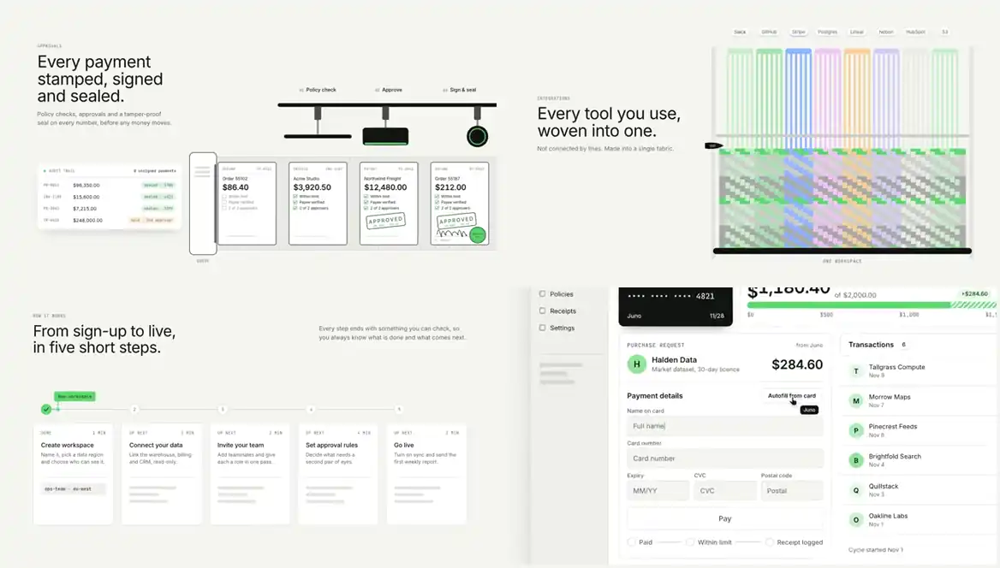

# site-motion

Animated website scenes in your own design system, without a motion designer.

[](https://sitemotion.dev)

**[Watch every scene](https://sitemotion.dev)** · **[Product demos](https://sitemotion.dev/demos)** · **[Style Studio](https://sitemotion.dev/studio)** · **[Docs](https://sitemotion.dev/docs)**

Give it your brand's tokens (colours, type, radius) and a few lines of copy, and it gives you a scene that tells your product's story: a payment stamped, signed and sealed; tools woven into one fabric; a storm your users never notice. Every scene is one HTML file:

- **Live:** it plays on your site, scales to its container, pauses offscreen, and shows a still frame under reduced motion.
- **Files:** it renders frame-exact to MP4, WebM, animated WebP, GIF and a poster, because every scene is a pure function of time.

It is also a [Claude Code skill](SKILL.md): ask for "a hero animation for our approvals feature in our brand" and Claude picks the scene, writes the content and renders it.

## Quickstart

Needs Node 22+, Chrome and ffmpeg. No `npm install`.

```bash
git clone https://github.com/Shivraj97/site-motion
cd site-motion
node bin/site-motion.mjs make ledger-stamp --tokens ledger --formats mp4,webp,png
```

Your files land in `out/ledger-stamp-ledger/` (scene, then brand). To use your own brand, copy `tokens/default.json`, change the colours and fonts, and pass `--tokens your-brand.json`. To change the words, pass `--content your-copy.json` with only the keys you change.

### Add a scene to your project

Copy a scene's source into your site so you own it, the way shadcn/ui copies components. Run this from your project:

```bash
npx github:Shivraj97/site-motion add ledger-stamp --tokens mint
```

(Or `node path/to/site-motion/bin/site-motion.mjs add …` from a clone.) It writes `public/motion/` if your project has a `public/` folder, otherwise `motion/`:

- `ledger-stamp/scene.js`, `scene.css`: the motion. Edit freely.
- `ledger-stamp/content.json`: the copy. `ledger-stamp/tokens.json`: the brand.
- `ledger-stamp/index.html`: a dev page that re-reads the JSON on refresh. Open it through your dev server, not `file://`.
- `ledger-stamp.html`: one self-contained file to embed, for example `<iframe src="/motion/ledger-stamp.html" style="width:100%;aspect-ratio:16/9;border:0" loading="lazy"></iframe>`.
- `runtime/`: the player and any library the scene needs, shared by every scene you add.

After editing, rebuild the embed with the command `add` prints. `build`, `render` and `make` all take the copied folder as their scene, so you can still export video from your own version. Pass `--content copy.json` to start from your own words, `--dir` to choose the folder, and `--force` to overwrite a scene you added before.

### One look for the whole site

Tokens give every scene your colours and fonts. A **style pack** goes further: line weight, shadows, corners, texture, label voice, type scale, motion curves and tempo, and a recurring motif. So your hero, feature and CTA animations look like they came from the same studio.

The first `add` locks the look. It writes `site-motion.json` with the pack that scene belongs to, and every scene you add after it follows that pack:

```bash
npx github:Shivraj97/site-motion add card-story      # locked style "soft-ui" (from card-story)
npx github:Shivraj97/site-motion add drop-pile       # matches it
npx github:Shivraj97/site-motion style set ink       # change the look for the whole site…
npx github:Shivraj97/site-motion sync                # …and restyle every scene already added
npx github:Shivraj97/site-motion style set outline --only motion,label   # or take just some knobs from another pack
```

| Pack | The look |
|---|---|
| `ink` | flat shapes, crisp ink outlines, no shadows, ruled paper, mono labels |
| `soft-ui` | interface cards on soft shadows with a hairline ring, accent on ink, cascading entrances |
| `outline` | ink outline on everything, hard offset shadows, round corners, a little bounce |
| `dimensional` | deep shadows, tonal ramps, soft glow, an unhurried pace |
| `field` | hairlines, sharp corners, a dithered surface, slow ambient motion |

Every pack has a short code (`site-motion style list`), such as `sm1.0020000000001`. Pass it as `--style` or add `?style=<code>` to any built embed to try a look live. `native` keeps each scene's own look.

Every public scene follows style packs. A scene only takes the parts of a look it was built for (its `meta.json` `directable` list), so anything it draws on purpose, like a painted landscape, stays as drawn.

Or try looks in the browser: the [Style Studio](https://sitemotion.dev/studio) puts one scene side by side, before and after, as you turn each knob, then gives you the code, a CLI line or a prompt for your coding agent.

### Plan the whole site at once

Instead of picking scenes one by one, give site-motion the site and approve one sheet:

```bash
npx github:Shivraj97/site-motion theme https://yoursite.com --out brand.json   # your brand first (check its notes, fix by eye)
npx github:Shivraj97/site-motion plan --brief brief.md          # one "## page" heading, one "- slot: copy" line per section (below)
npx github:Shivraj97/site-motion plan --url https://yoursite.com  # or read your live pages' own headings (--depth 3 adds h3 cards)
npx github:Shivraj97/site-motion plan swap home.feature-2 galton-router   # change a pick, then: plan sheet
npx github:Shivraj97/site-motion plan apply                      # adds every scene, in one look, and prints each section's embed
npx github:Shivraj97/site-motion plan apply --bare               # the same, for a page that already sets each section's heading: scenes leave theirs out
```

A brief is your real copy, one heading per page and one line per section:

```markdown
## home
- hero: Close your books in a day, not a week.
- feature: Every payment checked, approved and sealed before money moves.
- feature: Connect your bank, payroll and CRM once.
```

The plan uses `brand.json` from the folder (or `--tokens <file>`); without one it says so and starts in the default colours. Every section gets one scene (each used once, matched on the stories its words name), all in the hero's look. `site-motion-plan.png` shows the whole set as it will ship, with the score's verdict on top. A pick that had no strong match is marked `?` and says what would have fit better.

### The same look for your own components

The scenes are only half the site. Export the project's look so your buttons, cards and transitions get the same shadows, corners, curves and label voice:

```bash
npx github:Shivraj97/site-motion style export --format tailwind --out app/look.css   # Tailwind v4 @theme: shadow-*, rounded-*, ease-*, colours, + sm-label/sm-motif/sm-texture
npx github:Shivraj97/site-motion style export --format css                            # plain :root custom properties and classes
npx github:Shivraj97/site-motion style export --format dtcg --out tokens/look.json    # W3C Design Tokens (DTCG 2025.10) for Figma plugins, Style Dictionary, Terrazzo
npx github:Shivraj97/site-motion style export --format design-md --out DESIGN.md      # rules for coding agents; replaces only its own marked section
```

### Keeping it one look

```bash
npx github:Shivraj97/site-motion lint --project      # raw values a look can't reach: stroke widths, shadows, radii, curves, stray hex colours, clock/random
npx github:Shivraj97/site-motion score --project     # measures each scene and names the odd one out, in a sentence
```

`score` reads line weight, elevation (flat or casting shadows), corner radius, label voice and how much of the frame is off the brand palette (ΔE2000), and tells you which scene doesn't match and why:

```text
Odd one out: card-story.
  card-story is off on elevation: it casts shadows, where the rest of the set is flat.
  card-story is off on corners: 9px corners, where the others run 3–6px.
```

It judges stills, so motion isn't scored, and a scene with little colour in it can't show a wrong brand. A value kept on purpose is marked in the scene source with `// sm-native: <why>` and lint lets it through.

### As a Claude Code skill

```bash
git clone https://github.com/Shivraj97/site-motion ~/.claude/skills/site-motion
```

Then, in any project: *"Use site-motion to make a reliability animation in our brand for the homepage."*

## Scenes

Each scene is organised by the story it tells, not by how it looks. Every scene in this repo is MIT, 38 of them; `node bin/site-motion.mjs list` prints them with their variants.

| Scene | Story | Renderer |
|---|---|---|
| `ledger-stamp` | approvals: payments are checked, stamped, signed and sealed on an indexed belt | SVG |
| `loom` | integrations: each tool a band of warp threads woven into one fabric | Canvas 2D |
| `weather-board` | reliability: a storm over one region of a status map, traffic reroutes, nothing fails | WebGL shader + DOM |
| `grain-tally` | metrics: grains of real events pour into the digits of the total, then sort into one bar per source | Canvas 2D |
| `lens-of-order` | messy → structured: a lens classifies a dithered field of maybes into labelled, outlined classes | Canvas 2D |
| `domino-run` | automation: one trigger tips a chain of dominoes; each step lights as the wave reaches it | Matter.js |
| `galton-router` | routing: a rule moves payments to the processors most likely to say yes | SVG |
| `receipt-printer` | messy → structured: documents in, a receipt with confidence scores out | DOM + SVG |
| `score-sheet` | orchestration: a multi-agent run played as a musical score | SVG |
| `signal-field` | messy → structured: noisy signals leave a gate as clean lanes | p5.js |
| `drop-pile` | many → one: work items fall into one tray with real physics | Matter.js |
| `bloom-flow` | automation: a workflow runs and each step blooms into generative flowers | Canvas + SVG |
| `iso-blocks` | infrastructure: blocks with live data on their faces over a tiled floor | SVG |
| `css3d-stack` | architecture: real HTML layers lift apart in CSS 3D while a request drops through | CSS 3D |
| `card-story` | a workflow that removes work: a feature list drives a product card through states | DOM |
| `window-stack` | "works where you work": app windows over a painted backdrop, an agent doing steps | Canvas + DOM |
| `leaderboard` | credit: contributions land, points count up, rows re-sort | DOM |
| `water-slide-funnel` | conversion funnel: riders slide one ramp per stage; each lip's pool catches that stage's drop-offs | SVG |
| `cell-division` | database branching: main divides into branches, one is discarded, one merges back with its change | Canvas 2D (metaballs) |
| `tree-rings` | year in review: one ring per year, as wide as the year was busy, with notches for the firsts | SVG |
| `parchment-changelog` | changelog: a scroll unrolls one release at a time, each inked as it ships | SVG + DOM |
| `moving-boxes` | migration: a hand truck carries each old tool's box into the new building, nothing lost | SVG + DOM |
| `pigeonhole-wall` | memory: documents file into labelled pigeonholes, and a request pulls the three sources it needs | SVG + DOM |
| `radar-sweep` | observability: every running job is a blip on a radar scope; a cursor reaches in and pauses the one that's failing | Canvas 2D + DOM |
| `press-qa` | testing: builds roll off a press; an arm flicks the one with a failing test down a chute and it passes on the re-run | SVG |
| `crate-discrepancy` | reconciliation: trays lift out of a crate and tick off the packing slip; the short one floats up with its note | SVG + DOM |
| `balance-scale` | quality vs cost: three pan balances, each tilt computed from the scores; ours tips to quality while the rivals sag to cost | SVG |
| `step-rail` | how it works: a token travels numbered steps, each opens on what it produced, and the last lands the result | SVG + DOM |
| `pipeline-board` | pipeline: cards advance column by column on a kanban board while counts and totals follow them | DOM |
| `account-health` | retention: a health table replays the month; one account slips, a playbook fires, and it recovers | SVG |
| `split-wipe` | before / after: a divider sweeps across scattered manual work and each fragment snaps into an ordered, resolved row | DOM |
| `roadmap-rail` | roadmap: a Today marker walks the time axis; shipped milestones fill in and the key launch opens into a card | SVG |
| `trust-rings` | security: requests pass concentric control rings around the data; the unauthorised one is stopped and logged | SVG |
| `agent-checkout` | payments: an agent pays by virtual card; the form fills, the limit meter moves and the receipt joins the list | DOM + ui-kit |
| `click-to-done` | onboarding: the cursor invites two teammates, picks a role and sends; the camera pulls back as the team grows | DOM + ui-kit |
| `dashboard-push` | analytics: revenue builds from the line as it draws, and the camera pushes in on the best day | DOM + ui-kit |
| `phone-stack` | notifications: alerts land on a lock screen, and a tap opens the newest in the app | DOM + ui-kit |
| `shot-demo` | your product: your own screenshot, typed into and clicked through, with a camera | DOM + ui-kit |

<details><summary><b>49 more, site-motion Pro</b>: watch them at <a href="https://sitemotion.dev">sitemotion.dev</a>; they aren't in this repo</summary>

| Scene | Story | Renderer |
|---|---|---|
| `live-room` | multiplayer: cursors, a proposal, a vote, a change shipping | Canvas + DOM |
| `gold-pan` | search-as-you-type: every keystroke swirls the pan until three priced nuggets are left | Canvas 2D |
| `museum-heatmap` | product analytics: visitor footprints warm the floor around the features people stop at; the ranking comes from the heat | Canvas 2D |
| `scratch-off` | prediction: foil scratches off the real departure time before the airline's board catches up | Canvas 2D |
| `sieve-tray` | early detection: markers fall through a fine mesh; the few that catch are lifted out and flagged | Matter.js (baked) |
| `rube-goldberg` | before / after: a receipt marble jams in five old contraptions, then drops down one chute in a second | SVG |
| `language-balloons` | localisation: word bubbles in eight scripts float up and assemble each locale's sentence, RTL included | Matter.js (baked) |
| `balloon-deploy` | deploys: each build step inflates the envelope; at 100% the release lifts off | SVG |
| `pufferfish` | autoscaling: a pufferfish swells to match each traffic wave while a fixed-capacity fish gets tossed | SVG |
| `gear-tiers` | pricing: plans drawn as camping kit, tent to basecamp, with a monthly / annual toggle | SVG |
| `permission-chessboard` | roles and permissions: each role piece lands on the board and lights only the squares it may use | SVG |
| `privacy-pebbles` | PII redaction: a squeegee turns every personal detail into an identical pebble; the sentence still reads | SVG + DOM |
| `ant-trail` | auto-categorisation: ants carry each swipe's receipt, memo and approval to the right ledger slot | Canvas 2D |
| `sunrise-payroll` | global payroll: a sunrise crosses eight time zones and pays each city at its own 9 am | SVG |
| `whiteout` | calm: a busy dashboard dissolves into fog, leaving the one number that matters | WebGL shader + DOM |
| `ink-flood` | theming, white-label: a paint chip floods the whole product in a new colourway | SVG |
| `integration-deck` | integrations: every tool is a key on one isometric macro pad; a workflow plays as a chord while a run log types each step | Three.js |
| `margin-rails` | provenance: a memo writes itself while passages carried forward from past files slide in on rails naming their source | SVG + DOM |
| `redline-front` | contract review: a review front sweeps down the document and returns it as a finished redline with verified authorities | SVG + DOM |
| `projector-sheets` | environments: production, staging and a pull request stack as acetate sheets; lift the PR sheet off and the wall snaps back | CSS 3D |
| `zip-merge` | realtime merge: two cursors pull a zip closed, each tooth one person's keystroke, into one line with no conflicts | SVG |
| `dandelion` | email analytics: each seed of a blown dandelion is a batch of emails, tallied where it lands: meadow, bounce fence or spam | Canvas 2D |
| `rivers-topo` | attribution: traffic is a river on a contour map, one branch per channel as wide as its share; a campaign widens one | Canvas 2D |
| `keystroke-machine` | prompt → product: each phrase drops a machine part; on Run a ball rolls through it and lights the output | Matter.js |
| `bead-views` | one record, many views: a bead stays still while its string re-threads a calendar, a board, a map and a timeline | SVG |
| `tennis-correction` | learning from corrections: a wrong answer is lobbed back over the net with the fix on it, and the next serve lands in | Canvas 2D |
| `dehydrator` | summarisation: a web page on a dehydrator tray dries to its key sentences, a tenth of the tokens | DOM + SVG |
| `agent-trace` | AI agents: one run as a trace of thinking, tool calls and results on a shared time axis, resolving into the answer | DOM |
| `inbox-triage` | triage: incoming requests are tagged and routed into team queues with SLA timers; the urgent one jumps the line | DOM + SVG |
| `plan-ladder` | pricing: a real pricing table fills itself in plan by plan; the recommended plan lifts and billing flips to yearly | DOM |
| `kpi-bento` | analytics: four KPI tiles read one set of numbers; a highlighted period sweeps them and the headline lands | SVG |
| `chat-to-action` | AI assistants: a message's key phrases snap into a structured card, then the actions run and a reply comes back | DOM |
| `coverage-map` | scale: a dot-matrix world map with live regions; a new one comes online and joins the list | Canvas 2D |
| `agent-chat` | AI agents: asked to close the month, the agent streams its reply, runs tool calls one at a time and the books roll to the reconciled total | DOM + ui-kit |
| `thread-approve` | approvals: an agent posts a plan in team chat; one click on Approve cascades each step to done | DOM + ui-kit |
| `doc-extract` | documents: a dropped claim is read field by field, each value wired to the form it lands in, ending in a decision | DOM + ui-kit |
| `computer-use` | automation: an agent cursor operates an old desktop app while a run log ticks off each step | DOM + ui-kit |
| `voice-call` | voice agents: a live call on a phone, transcript streaming, the booking flying onto the schedule | DOM + ui-kit |
| `table-edit` | operations: an agent fixes flagged table rows inline, and the recovered total adds up from them | DOM + ui-kit |
| `code-finding` | security: a finding is marked in code, its path traced, and the fix replaces the line | DOM + ui-kit |
| `agent-fleet` | observability: a live fleet of agents; one fails, a retry recovers it, and health returns to its true value | DOM + ui-kit |
| `command-palette` | keyboard flow: a command palette filters as you type, and one Enter runs the action | DOM + ui-kit |
| `drag-reorder` | prioritisation: an agent suggests a move; the card is dragged into place and the projection follows | DOM + ui-kit |
| `cowrite-doc` | collaboration: a person and an agent edit one document; a sourced suggestion is accepted | DOM + ui-kit |
| `swipe-apply` | B2C agents: swipe through matches on a phone while the agent applies and books | DOM + ui-kit |
| `calendar-shuffle` | scheduling: a late change causes a conflict, and the agent reshuffles the board around it | DOM + ui-kit |
| `connect-apps` | permissions: connect an app with scoped toggles, leaving the risky one off | DOM + ui-kit |
| `terminal-agent` | coding agents: a task runs in a terminal, tests fail, get fixed, and go green | DOM + ui-kit |
| `demo-bento` | platform overview: a bento of live mini demos, relaying one action across the features | DOM + ui-kit |

</details>

## Commands

```bash
node bin/site-motion.mjs list                                   # scenes, token presets and style packs
node bin/site-motion.mjs init --tokens ./brand.json --style ink # site-motion.json: one brand and one look for the project
node bin/site-motion.mjs style list | show | set <pack|code>    # the project's look (--only knob,knob for a partial apply)
node bin/site-motion.mjs sync                                   # restyle every added scene after a brand or look change
node bin/site-motion.mjs style export --format css|tailwind|dtcg|design-md [--out file]   # the look for your own components
node bin/site-motion.mjs check <scene|all> [--style ink]        # determinism, loop seam, contrast, text fit; in a project: your copy, its brand and look
node bin/site-motion.mjs lint <scene|all> | --project           # source rules: determinism, token colours, no raw values on followed axes
node bin/site-motion.mjs score <scene[@look]…> | --project      # does the set look like one site? names the odd one out
node bin/site-motion.mjs plan --brief b.md | --url … | --pages … # one scene per section, one look, a contact sheet to approve
node bin/site-motion.mjs plan show | sheet | swap <slot> <scene> | apply
node bin/site-motion.mjs add <scene> --tokens mint              # copy the scene's source into your project (you own it); demos: --view card --play once
node bin/site-motion.mjs init <scene> --tokens mint             # writes ./brand.json and ./<scene>.json to edit
node bin/site-motion.mjs build <scene> --tokens … --content …   # one HTML file
node bin/site-motion.mjs render <file.html> --formats mp4,webm,webp,gif,png,sheet
node bin/site-motion.mjs make <scene> --tokens … --content …    # build + render
node bin/site-motion.mjs theme https://yoursite.com --out brand.json   # draft your tokens from a live site
node bin/site-motion.mjs shot screen.png --name acme              # a screenshot of your product → a product demo (shot-demo)
node bin/site-motion.mjs rehearse <demo> --tokens …              # a product demo's last pass: every check, phone-width sheet, review note
node bin/social.mjs brands/<brand>/social.json                  # 9:16 social cuts (render the scenes it names first)
```

Token presets: `default`, `mint`, `ledger`, `night`.

## Product demos and agents

A product demo is your product's screen rebuilt in the browser, with a cursor doing one job and a camera following it. Start from one of the free demos (`click-to-done`, `dashboard-push`, `phone-stack`, `agent-checkout`), from a screenshot with `shot`, or ask Claude to build a new screen with `runtime/ui-kit.js`. The walkthrough is in [the docs](https://sitemotion.dev/docs).

**MCP server:** `node mcp/server.mjs` serves ten tools over stdio (list scenes, theme from a URL, build, render, export the look, plan a site, add a scene, sync the project, check a scene, a demo from a screenshot) for Cursor, Codex or any MCP client.

## How it works

A scene is `setup()` once and `render(t)` every frame, and `render` may only depend on `t`. That one rule lets the same file play live in a browser and export frame-exact video: the exporter seeks headless Chrome to every frame time, screenshots, and encodes with ffmpeg. Physics is simulated once and baked; loops are checked with PSNR so the seam is invisible. [RENDERERS.md](RENDERERS.md) covers SVG, Canvas, p5, Matter.js, shaders and CSS 3D; [SKILL.md](SKILL.md) is the full guide.

## Licence

MIT. Vendored libraries keep their own licences, listed in [THIRD_PARTY.md](THIRD_PARTY.md).
